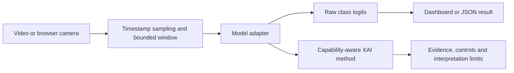

# Architecture and contracts

There are two extension boundaries: **models** and **explanation methods**. A registry is a dictionary of names mapped to `module:Class`; custom import paths can be supplied through trusted local configuration/CLI. No remote plugin loading or large orchestration system is needed.

The framework sends sampled, unresized **RGB uint8 `[T,H,W,3]`** clips to adapters. Adapters own resizing, normalization, tensor axes, device selection and output decoding. They return finite **raw logits `[classes]`**, in the configured label order. The framework computes softmax only for display; scores are not calibrated probabilities of correctness. Adapters must reset streaming state on each independent call. Supporting persistent streaming is a different contract and requires explicit session ownership.

Capabilities are explicit: `predict`, `linear_head`, `spatial_gradients` and `channels`. Black-box interventions need only prediction; internal explanations need additional hooks. A linear-head adapter returns features, weights and bias in exactly the same coordinate system. A spatial or channel hook must replay unchanged inference within numerical tolerance before being trusted.

The server loads one adapter per process. Camera sessions have separate timestamped buffers. A four-second KARD window contains 20 sampled frames. Resolution changes or long frame gaps clear context; timestamps cannot move backwards. A single model lock prevents concurrent access to stateful runtime objects. Each connection has at most one pending compute task. While computation is busy, obsolete windows are skipped. Uvicorn and the browser also bound their message buffers. This is a local research dashboard, not a horizontally scaled multi-user service.

Explanations use a copy of the last completed prediction window, with its timestamp reported. Predictions pause while the model lock is held by XAI. Spatial thumbnails are returned in memory; no frame files are written. A camera disconnect clears its buffer. Closing the browser stops its media tracks. Runtime failures produce visible errors rather than demo predictions.

Host/origin checks, payload limits and loopback binding prevent accidental broad exposure. They do not supply user authentication or guarantee privacy. Public deployment would require authentication, TLS, rate limits, resource isolation and an explicit data policy; that deployment is outside this local framework.

Experiments should save model/weight hashes, preprocessing policy, clip identity/hash, target/rival classes, seeds, reference choices and numerical output. `predict`, `explain` and `benchmark` record model provenance. Preserve training/validation/test separation and distinguish source-video perturbations from internal feature interventions. See the research reports for interpretation.
