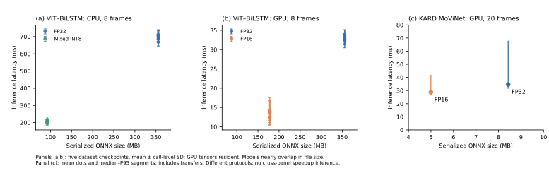

# Measured size, precision and execution behavior

All reported numbers come from archived measurements, not fresh runs created
for this documentation update. [Research accuracy studies](../research/README.md)
use different checkpoints/protocols and must be attributed separately.

## Available benchmark groups

| Group | Input and state policy | Timing scope | Evidence |
|---|---|---|---|
| Five dataset-specific ViT-B/16–BiLSTM heads | Batch 1, 8 RGB frames, 224²; FP32/FP16 and mixed dynamic INT8 | CPU and GPU in separate blocks; GPU tensors resident, transfers excluded | [Tables and methods](size-latency/README.md), [original export validation](vit-bilstm/EXPORTS.md) |
| Historical KARD MoViNet CPU/CUDA | Batch 1, 20 RGB samples, 172², 5 fps; fresh states | Model invocation includes ONNX transfers and synchronous CPU output | [CUDA report](cuda/REPORT.md) |
| Official pretrained MoViNet A0-Stream/A2-Stream/A2-Base | Separate 1-frame retained-state and 8-frame fresh-state runs; 600 classes | Native TensorFlow CPU, fixed tutorial input | [Scale/execution report](official-movinet/REPORT.md) |
| 5/10-fps KARD sampling | Up to 50/100 frames over max 10 s; fresh state per video | Recognition quality only; **no latency measurements** | [Sampling study](../research/sampling/REPORT.md) |

The Xeon w7-2595X / RTX 4000 Ada results describe this workstation and recorded
runtime versions. They are not mini-PC, physical-webcam or end-to-end browser
latencies. All groups exclude model loading, capture/display and XAI.

## Default KARD checkpoint: measured deployment paths

| Runtime | Artifact size MB | Model mean / median / P95 ms | App processing mean / median / P95 ms |
|---|---:|---:|---:|
| TensorFlow CPU FP32 | 26.363 | 121.30 / 119.61 / 139.36 | 283.23 / 287.85 / 314.77 |
| ONNX CUDA FP32 | 8.430 | 34.61 / 31.74 / 67.58 | 94.66 / 91.90 / 121.27 |
| ONNX CUDA FP16 | 4.997 | 28.73 / 26.69 / 41.71 | 103.33 / 103.17 / 126.28 |

TensorFlow size counts the complete SavedModel directory; ONNX counts a graph
file. Decimal MB are disk bytes, not RAM/VRAM. Compared within ONNX, FP16 is
40.73% smaller. App processing is a **separate workload**, so do not subtract
the columns to estimate preprocessing cost. Includes pixel preprocessing and
prediction formatting; excludes decoding, capture and display. FP16 model-only
speed does not imply faster full app processing in this recorded trial.

The artifacts here use the [historical model-card checkpoint](../../models/kard/MODEL_CARD.md).
Do not combine these latencies with the later ablation/LoRA accuracy as though
they described one deployed checkpoint.
The table reports the same measured files; their bytes are now obtained through
[authenticated private setup](../private-weights.md), rather than public Git.

## Coverage and missing measurements

- Four base architectures and nine checkpoint/classifier configurations have
  archived latency: five ViT heads, three pretrained MoViNets and KARD A0.
- There are 31 model/runtime/precision combinations: five forms per ViT model,
  three pretrained FP32 models and three KARD runtime/precision forms.
- There are 26 saved inference artifacts; the five PyTorch FP16 models were
  measured in memory without separate saved files. Devices, seeds, reruns and
  intermediate conversions are not extra model sizes.
- FP16 is reduced floating-point precision. The ViT INT8 export dynamically
  quantizes constant MatMul/LSTM weights and retains other floating operators.
- No GPU INT8, MoViNet INT8, INT4, static INT8/QAT, TensorRT or TFLite benchmark
  is reported in this inventory. No full-model latency exists for the new
  compact heads or merged adapters.
- The 1/8/20-frame records are separate execution modes, not a controlled
  same-checkpoint frame-count sweep. One-frame streaming retains earlier input
  history. Sampling rate, input length and temporal context are distinct.

The [full CSV](size-latency/model_size_latency.csv), [size/hash audit](size-latency/size_latency_audit.json),
[article tables](size-latency/article_tables.tex) and [vector trade-off plot](size-latency/size_latency_tradeoff.pdf)
retain the definitions and unmeasured entries.

## Conversion agreement

ViT ONNX FP16 retained the FP32 top-one prediction on all nine supplied windows
per model. Original mixed-INT8 export checks retained 9/9 for KTH/UCF45-DS and
8/9 for UAV/KARD/HON4D. MoViNet ONNX FP32/FP16 each retained 18/18 sampled
TensorFlow validation predictions. These checks measure conversion agreement,
not held-out task accuracy. Quantized predictions can change.

Raw ViT observations are preserved by session under `vit-bilstm/`; earlier GPU
FP32 measurements are retained as historical evidence, while the newer paired
FP32/FP16 session supplies the GPU article table. Do not pool those sessions.
MoViNet KARD retained aggregates only, so its missing call-level SD is not
reconstructed. Timing-call, training-seed and subject-fold SDs are different.
