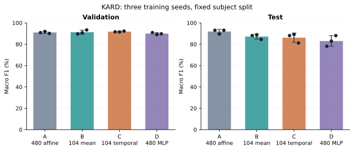
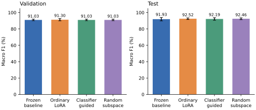

# Research results and ablations

This index reports successful, mixed and negative studies. It distinguishes the
historical deployed model from later research heads and separates fold variation,
training-seed variation and timing-call variation. All KARD protocols here are
researcher-defined; earlier results were already observed. These are exploratory
evaluations, not newly blind external benchmarks.

## Which checkpoint does a result describe?

| Identity | Role | Reported test result | Deployed? |
|---|---|---|---|
| Historical TensorFlow full-training-pool affine head | Dashboard, five XAI studies, checked ONNX exports | 94/108 correct; 87.04% accuracy; 86.80% macro F1 | **Yes** |
| Fresh PyTorch affine controls A | Matched three-seed architecture baseline | 92.28 ± 2.14% accuracy; 91.93 ± 2.03% macro F1 | No |
| Validation-selected projection adapters | Three-seed adapter comparison | See adapter report; ordinary LoRA mean macro F1 92.52% | No |

The latter two rows are means across different trained heads, not a single model
that the dashboard has been shown to run. Do not attach their accuracy to the
deployed model's CUDA latency or XAI findings.
[Model card](../../models/kard/MODEL_CARD.md) identifies the historical checkpoint.

## Completed comparisons

| Study | Main observation | Evidence and scope |
|---|---|---|
| [Temporal sampling](sampling/REPORT.md) | 5 fps: 87.78 ± 4.90% accuracy / 87.02 ± 5.35% macro F1; 10 fps: 85.43 ± 4.41% / 85.03 ± 4.39% | Five fold means after averaging three seeds per fold; caps 50/100, max 10 s. No latency comparison |
| [Architecture controls A/B/C/D](architecture-ablations/REPORT.md) | Test macro F1: A 91.93, B 87.19, C 86.17, D 83.03%; C−B −1.02 points | Three seeds and equal L2 tuning budgets; mean ± seed SD in full report. No full-model speed/size claim |
| [Projection adapters](projection-adapters/REPORT.md) | Baseline 91.93; LoRA 92.52; guided 92.19; random 92.46% macro F1 | Three matched seeds; gains concentrated in one seed. Classifier guidance did not beat equal-budget random guidance |
| [Training-data efficiency](data-efficiency/REPORT.md) | 81/162/324 training clips: 75.00/81.48/87.04% test accuracy | Nested 25/50/100% **of the 324-clip training pool**, not of all 540 videos; one seed |
| [Upper fine-tuning](upper-finetuning/REPORT.md) | Five real training epochs did not beat initial validation macro F1; epoch zero selected | Negative result; repeated original test score is not an improved fine-tuned checkpoint |
| [Original compact pilot](architecture-ablations/single_seed_pilot/REPORT.md) | Initial single-seed test accuracy 93.52% looked promising | Preserved alongside the later controlled three-seed comparison, which did not support the same conclusion |
| [Representation diagnostic](projection-adapters/diagnosis/REPORT.md) | Reordering spatial pooling before the pretrained projection strongly shifted fixed-classifier predictions | Train/validation-only intervention with unchanged historical head; not a causal explanation of separately retrained compact heads |
| [Person crops](person-crop/REPORT.md) | Some demonstration predictions improved; others did not | Four videos, pretrained Kinetics label space, offline union crop; not target-dataset accuracy or a causal live tracker |

Report negative outcomes and epoch-zero fallbacks. A validation fallback protects
the recorded validation selection score, not unseen test accuracy. Do not select
the best test seed, fold or checkpoint as a deployment model.

## Explanations of the deployed model

[Interpretations and controls](INTERPRETATION.md) bring together the five methods.
The strongest evidence is bounded intervention sensitivity and exact affine-head
arithmetic. The techniques answer different questions.

| Method | Supported interpretation | Limit |
|---|---|---|
| [Spatial](spatial/REPORT.md) | Coarse candidate regions with mixed blur-intervention results | Three-clip pilot, 6×6 activation grid; plausible overlays do not establish spatial faithfulness |
| [Temporal](temporal/REPORT.md) | Sensitivity to reversal, shuffle, repeated frames and local interventions | Cohort-level controls and prefix behavior; interventions can be out of distribution |
| [Concept proxies](concept/REPORT.md) | Action-family information is linearly available; direction deletions affect the classifier | Labels are proxies, not independent human-concept annotations; semantic transfer is partial |
| [Contrastive](contrastive/REPORT.md) | Exact feature-coordinate accounting for named class-pair margins | Arithmetic exactness does not make coordinates semantic or produce realistic video counterfactuals |
| [Channel interventions](mechanistic/REPORT.md) | Removal/retention effects of training-selected groups with controls | No demonstrated minimal, sufficient class-specific circuit; collateral effects matter |

These explanations apply to the historical deployed checkpoint and reused
validation cohort. They were not rerun on the stronger experimental heads.
Running a portable XAI method once does not reproduce the full original study.
The additional channel-retention selectivity analysis was result-triggered and
is labeled exploratory. The [independent semantic-validation protocol](SEMANTIC_VALIDATION_NEXT.md)
is proposed future work; [the parent numerical audit](parent_numerical_audit.json)
checks consistency rather than human concept validity.

## Benchmarks, article assets and reproduction

- [Benchmark index](../benchmarks/README.md): CPU/GPU precision, file sizes,
  pretrained model scales and separate streaming/windowed execution modes.
- [Article tables](../benchmarks/size-latency/article_tables.tex): `booktabs`
  snippets with timing, size and sampling notes.
- [Verified aggregates](VERIFIED_SUMMARY.md): independently recomputed using
  `python experiments/report_results.py`.
- [Reproduction/source archive](../../experiments/README.md): report reproduction
  is self-contained; historical training requires the external dataset and
  original workspace/caches.
- [Publication manifest](publication_manifest.json): source and published hashes.
  Original hashes embedded in normalized text still refer to the historical
  workspace files, not necessarily the normalized copies.

Large ViT binaries, datasets, raw frame illustrations and activation caches are
not part of this research publication. Numeric plot inputs, protocols, selected
compact experimental heads and vector/raster article figures are included.
