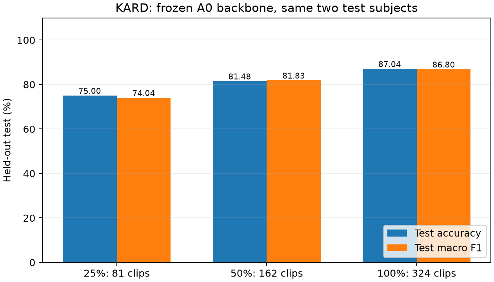
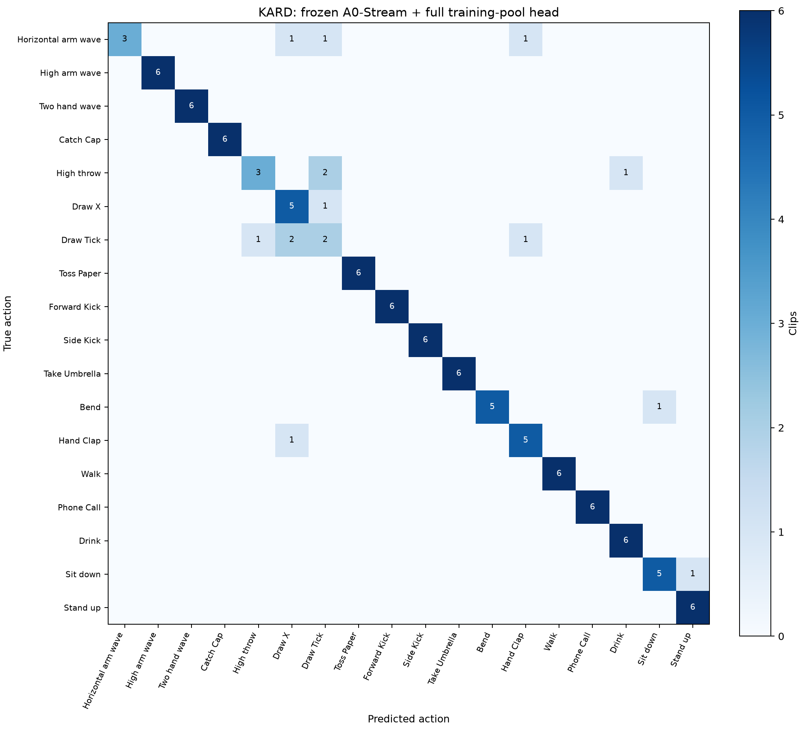

# KARD MoViNet A0-Stream: 25%, 50% and 100% training-pool comparison

The full training-pool classifier was trained from initialization using all 324 clips from the six fixed training subjects. This is 100% of the training split, or 60% of the complete 540-clip dataset. The remaining 108 validation clips and 108 test clips are held out by subject. The official pretrained backbone remains frozen; only the 18-class head is trained.

## Fixed protocol

- Training subjects: 1, 3, 4, 6, 7, 8. Validation: 5, 10. Test: 2, 9. No subject overlap.
- Nested training subsets of 81, 162 and 324 clips. The full subset has 18 clips per action, 54 per subject, 108 per repetition, and three repetitions per action/subject pair.
- All 540 source SHA-256 hashes were reverified. The earlier complete sequential-decoding audit was reused; source files did not change.
- Identical RGB [0,1] input, resize with padding to 172x172, 5 fps, centered window of at most 10 seconds/50 frames, fresh streaming states per clip, eight-frame extraction chunks. No crops or video augmentation.
- Frozen 480-dimensional pooled A0 features; standardization fitted separately on each training subset; dropout 0.25; Dense(18) logits, 8,658 trainable parameters.
- Same seed 42, Adam at 0.001, batch 16, maximum 200 epochs, patience 25. Prespecified L2 candidates 0.0001, 0.001 and 0.01. Choose checkpoint and candidate by validation macro F1, then lower validation cross entropy.
- Heads initialized afresh. No continuation of earlier classifier weights. Native Windows TensorFlow CPU in the Miniconda xai environment.
- 270 train/validation feature files reused from the 50% run, 162 new training features extracted, then 108 test features reused after model selection. Source, model, manifest, label and input-policy checks establish cache provenance. Backbone contents remained unchanged.

**Earlier test results were already observed.** This is a planned comparison on the same fixed test set, not a newly blind test. Model selection uses validation only; no post-test tuning was performed. There are only two test subjects, no cross-validation and no statistical-significance claim. This is a researcher-defined split, not an official KARD benchmark protocol.

| Training pool used | Train clips | Train accuracy | Validation accuracy | Validation macro F1 | Test accuracy | Test macro F1 |
|---|---:|---:|---:|---:|---:|---:|
| 25% | 81 | 100.00% | 85.19% | 85.14% | 75.00% | 74.04% |
| 50% | 162 | 100.00% | 89.81% | 89.56% | 81.48% | 81.83% |
| 100% | 324 | 100.00% | 88.89% | 88.77% | 87.04% | 86.80% |

The full-training classifier changes test accuracy by +5.56 percentage points versus 50%, and +12.04 versus 25%. It corrects 8 mistakes from the 50% model and introduces 2 errors on clips that model classified correctly. These are descriptive paired-clip counts.

The 100% winner uses L2 0.01, selected epoch 19. Training the three candidate heads and selecting by validation took 14.9 seconds, excluding feature extraction.

| L2 candidate | Selected epoch | Validation accuracy | Validation macro F1 |
|---:|---:|---:|---:|
| 0.0001 | 32 | 88.89% | 88.68% |
| 0.001 | 32 | 88.89% | 88.68% |
| 0.01 | 19 | 88.89% | 88.77% |

| Action | Correct / 6: 25% | Correct / 6: 50% | Correct / 6: 100% |
|---|---:|---:|---:|
| Horizontal arm wave | 3/6 | 4/6 | 3/6 |
| High arm wave | 3/6 | 3/6 | 6/6 |
| Two hand wave | 6/6 | 6/6 | 6/6 |
| Catch Cap | 6/6 | 6/6 | 6/6 |
| High throw | 2/6 | 4/6 | 3/6 |
| Draw X | 5/6 | 4/6 | 5/6 |
| Draw Tick | 0/6 | 0/6 | 2/6 |
| Toss Paper | 6/6 | 6/6 | 6/6 |
| Forward Kick | 6/6 | 6/6 | 6/6 |
| Side Kick | 6/6 | 6/6 | 6/6 |
| Take Umbrella | 6/6 | 6/6 | 6/6 |
| Bend | 5/6 | 5/6 | 5/6 |
| Hand Clap | 2/6 | 4/6 | 5/6 |
| Walk | 6/6 | 6/6 | 6/6 |
| Phone Call | 6/6 | 6/6 | 6/6 |
| Drink | 5/6 | 5/6 | 6/6 |
| Sit down | 2/6 | 5/6 | 5/6 |
| Stand up | 6/6 | 6/6 | 6/6 |





## Verification and use

End-to-end export versus cached-feature maximum logit difference: 1.91e-06; export reload difference: 0. Verification clip: Bend\a12_s02_e01.mp4. Reload and backbone-content checks passed.

`kard_head.keras` stores the trained head; `saved_model/` contains the complete frozen backbone and new classifier. `labels.json` defines the 18-class output order. `selection.json`, candidate histories and `evaluation.json` retain training and evaluation evidence. `comparison.json`, `class_comparison.csv` and test predictions provide reproducible comparison details.

Run `movinet_evaluation/run_kard_100_pipeline.ps1` from the workspace to resume/reproduce the declared stages. Existing frozen manifests and selected/evaluated results are preserved.

Inference example:

```powershell
& 'python' -B movinet_evaluation\predict_kard_video.py --experiment-dir movinet_evaluation\kard_a0_head_100pct --video 'C:\path\to\clip.mp4'
```